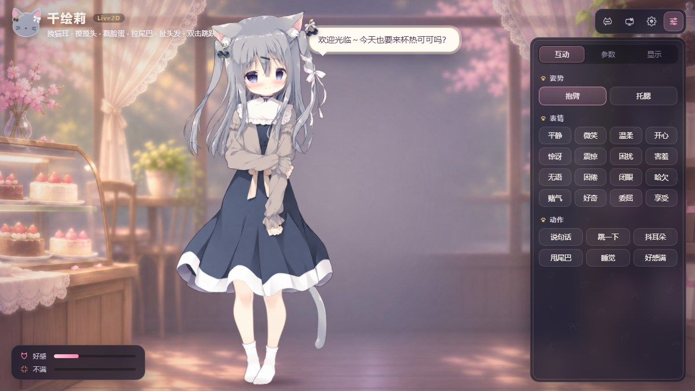

# Yukimura Chieri · a Live2D-style interactive desktop pet

[简体中文](README.md) | English



Two flat character illustrations (`1.png` / `2.png`) and the expression layers in `chc/` become a Live2D-style character you can interact with in real time. She breathes, blinks and looks around, gets angry when you pull her ears, and blushes when you pat her head. When the page loads, the illustration is cut into several layers in the browser and each layer gets a mesh. Hand-written deformers bend the meshes every frame, and WebGL2 draws the result. There is no Cubism, no `.moc3` and no runtime dependency.

The same page is also packaged with Electron as a Windows desktop pet (tray icon, transparent window, start at login). You can connect your own LLM API to chat with her and have her react to touches. Her lines can be read aloud with an online TTS service or the bundled GPT-SoVITS voice.

> This file covers usage. Code structure, how to change things, and development notes are in [CLAUDE.md](CLAUDE.md) (Chinese).
>
> The app's interface, her lines and all settings are in Chinese.

## Running from source

- **Web version**: on Windows, double-click `start.bat`. It starts a local server (`serve.ps1`, port 8765) and opens http://localhost:8765/. Any other static server works too, but the page must be served over http: browsers do not let a `file://` page read image pixels, and the expression masks are computed from pixels at load time.
- **Desktop version**: needs Node 22 or newer.

  ```bash
  npm install
  ```

  ```bash
  npm start
  ```

**Not in this repository**:

- The local voice model package `voice/Chieri_GPTSoVITS_20261103/`. It is about 1.4 GB, beyond GitHub's size limits. Without it the app runs normally, but the voice settings have no "千绘莉声线" (Chieri voice) engine. You can use an online TTS engine or connect your own GPT-SoVITS server instead.
- The installers (built with `npm run dist` / `npm run dist:lite`, see "Packaging"), `node_modules/`, and the promo video project.

## Running (installers)

- **Desktop version (recommended)**: there are two installers. Both add a "千绘莉" shortcut to the Start menu and the desktop. They are built with `npm run dist` / `npm run dist:lite` (see "Packaging") and are not in the repository.
  - `dist/千绘莉-完整版-Setup-<version>.exe` (full edition, about 1.2 GB): includes Chieri's own GPT-SoVITS voice model, so it can speak with the local voice or with online voices.
  - `dist/千绘莉-在线版-Setup-<version>.exe` (online edition, about 145 MB): no model, smaller, online voice services only.
  - You can install a new version over an old one without uninstalling first. The installer first stops any local voice process still running, so that old model files are not held open and can be replaced.

## Desktop pet

The monitor icon at the top right of the main window switches to desktop mode: she stands on her own on your desktop, with no background and no frame.

- Only the pixels of her body catch the mouse. You can click straight through the transparent area around her to the windows below.
- **Menu**: normally just a small dot at the top right, shown only while the mouse is over her. The toolbar (move, chat, resize, settings, back to the main window, more) opens only while the mouse is on the dot and closes when it leaves.
- **Moving her**: drag the opened toolbar by any part that is not a button, for example the drag icon at its left end. She sways while you carry her and lands with a little bounce when you let go.
- **Size**: adjustable in fine steps:
  - click the resize button on the toolbar, or choose "大小 → 无级调节…" (Size → Fine adjust…) in the right-click menu. Then drag the dot at the top left, scroll the mouse wheel, or click −/+. Click "完成" (Done) or press Esc when finished;
  - or hold Ctrl and scroll the mouse wheel over her;
  - the slider in the settings previews the size live while you drag it.
  - The range is 40%–250%, but never taller than the screen.
- **Chat and settings**: the window grows a column to the left to hold them, so they never cover her. What she says appears in the empty space above her head.
- Her eyes follow the mouse anywhere on the screen.
- Right-click her or the tray icon for:
  - **Layer**: topmost (above full-screen programs and the taskbar), always on top (above normal windows), or normal (like any other window).
  - **Size** and **click-through** (she blocks nothing at all; turn it off from the tray icon).
  - **Start at login**;
  - hide to the tray, and quit.
- Position, layer and size are remembered. The settings have an option to start directly in desktop mode ("启动时直接进入桌面模式").
- **Start at login**: tick it under "桌面宠物" (Desktop pet) in the settings, or turn it on in the right-click or tray menu.
  - After login, the "start in desktop mode" option decides whether the pet or the main window opens. Neither takes focus from the window you are using.
  - If you disabled it under Startup apps in Task Manager, the settings say so; ticking it again turns it back on.
  - Uninstalling removes it. Installing a new version over the old one leaves it as it is.

## AI chat

Open ⚙ Settings, pick a provider and fill in the API key and model:

- Supported: DeepSeek, Qwen (通义千问), Kimi, Zhipu (智谱), OpenAI, Claude, local Ollama, or any API compatible with OpenAI's `/chat/completions`.
- "测试连接" (Test connection) tries it once first.

Once it is set up:

- **Chat window** (💬): chat with Chieri. The model answers in character and also picks her expression (happy, shy, sulking…), an action (jump, swish her tail, twitch her ears, hearts…) and how her affection changes, and she acts it out on the spot.
- **AI touch reactions**: when on, patting her head, pulling her ears, poking her cheek and the like are described to the model, which writes her reaction instead of a fixed line. Her body still reacts immediately; until the reply arrives the bubble shows "…". When you touch her many times in quick succession she falls back to fixed lines.
- **Persona**: the default persona is the character sheet in `rg.txt` (a Russian Blue cat-girl café clerk, a tsundere who acts like your senior and does not say "nya"). Her name and persona can be changed in the settings. A default persona saved by an older version is replaced with the new one automatically; a persona you edited yourself is never overwritten.
- Her replies may include stage directions in （） such as "（猫耳抖了抖）" (her cat ears twitch). They are shown in the bubble and skipped when read aloud.
- **Hide chat log** ("隐藏聊天栏"): when ticked, chatting leaves only an input box with no history, and her replies appear only in the bubble above her head. Press Esc or the × left of the input box to close it.

Where data is kept:

- The desktop version stores API keys encrypted by the system (Windows DPAPI) in your user folder. Requests go from the app's main process straight to the address you entered, so there are no CORS problems.
- The web version keeps them in the browser's localStorage. Some providers block cross-origin requests from browsers.
- Without AI configured, the chat window answers with a few keyword replies and interactions use fixed lines.

## Voice

Under Settings → 语音 (Voice), pick a voice engine and every line she says is read aloud. Chat replies and touch reactions / everyday lines can be switched separately ("朗读聊天回复", "朗读触摸反应和日常台词"). Her mouth moves with the loudness of the audio. "试听" (Preview) plays one line first.

| Engine | Notes |
| --- | --- |
| 千绘莉声线 (Chieri voice; local GPT-SoVITS, Japanese) | Full edition only. The bundled voice model (a v2ProPlus model provided by 雪村落雪 on Bilibili) **speaks Japanese only**. The fixed lines come with Japanese translations (`js/lines_ja.js`); AI replies ask the model for a Japanese version at the same time; any other line is translated by the AI on the fly (so an AI service must be configured). Runs on your own machine, needs a Python environment, an NVIDIA GPU is recommended |
| GPT-SoVITS API (api_v2) | Full edition only. Connects to a GPT-SoVITS `api_v2.py` you run yourself (on this machine or your LAN); the model and reference audio are set on that server |
| OpenAI compatible | OpenAI, SiliconFlow and other services compatible with `/audio/speech` |
| Fish Audio / ElevenLabs / Azure Speech | Enter the API key and voice ID (for Azure: region, key and voice name) |

All engines except the Chieri voice work in any language: by default they read the Chinese text as is. With a Japanese voice, set "朗读语言" (reading language) to "先翻译成日语再朗读" (translate to Japanese first).

> Thanks to the model provider: the model was provided by Bilibili user 雪村落雪 (感谢模型提供者，B站id：雪村落雪提供的模型). The full edition's Chieri voice is GPT epoch 50 / SoVITS v2ProPlus epoch 20.

**Setting up the local voice** (first use):

1. Install 64-bit Python 3.12 (from python.org).
2. In the voice settings, choose "千绘莉声线" and click "一键安装环境" (one-click setup). The app creates a separate Python environment in `%LOCALAPPDATA%\chieri-tts` and installs PyTorch 2.7.1 and the packages the model needs: the CUDA 12.8 build with an NVIDIA GPU (about 3 GB to download), otherwise the CPU build. On networks in mainland China you can tick "使用国内镜像" (use a mirror in China): the packages then come from the Tsinghua mirror, while PyTorch still comes from the official source.
   - **Progress bar**: below the button a bar shows the current step (find Python → create the virtual environment → install PyTorch → install the GPT-SoVITS packages → check the environment), the overall progress, and which package is downloading, how much, how fast, and roughly how long is left. Moving stripes mean a step is running but cannot be measured exactly, for example while many files are unpacked. The full output is in the log box below it.
   - **The local voice does not work until the bar says "安装完成，运行环境已就绪"** (setup finished, environment ready); until then she makes no sound when she talks. On failure or cancel the bar turns dark red and says at which step it stopped and why.
   - If setup is cancelled, the network drops, or the app is closed during setup, the button changes to "继续安装" (continue setup). Click it to carry on; packages already installed are not downloaded again.
3. After setup, save the settings and the model loads in the background; you are told when it is ready. From then on it loads automatically at every start. The first load takes a minute or two. While PyTorch is being imported the log shows nothing new for a long time (every 20 seconds it says "仍在加载", still loading). **There is no need to click "加载 / 重启模型"** (load / restart model): clicking it during loading does not interrupt anything; only after 3 minutes does it really restart.
   - If one step takes more than a minute and a half, a block starting with "Timeout" appears in the log: that is the code it is running at that moment. If it is still not loaded after 10 minutes, it stops with an error. In that case, copy the whole log under the voice settings and send it to the developer; it shows where it got stuck.
4. If you already have a Python environment that runs GPT-SoVITS (a version that supports v2ProPlus), enter its `python.exe` in the "Python" field and skip setup. "检测环境" (check environment) lists the Python and PyTorch versions, the GPU and any missing modules.

Local synthesis is slower than online services: one or two seconds per line with a GPU, much slower on CPU only. "预生成固定台词" (pre-generate fixed lines) synthesizes all fixed lines ahead of time and stores them, so reactions like head pats and ear pulls speak immediately. Generated audio is stored in `tts-cache` in your user folder, shared by all engines, up to about 400 MB. AI replies are different every time and can only be made on the spot: the text waits up to 10 seconds for the audio (6 seconds for touch reactions), then appears anyway.

**After changing the model or updating**:

- What gets loaded is always the two weight files actually present in the install folder. The voice settings show which ones were loaded, for example "模型已加载（NVIDIA 显卡 · 雪村落雪 · GPT-e50 / SoVITS-e20 afb37bc7）", ending with the first 8 characters of the GPT weights' hash. If the weights do not match the hashes recorded in the model package, it says "和模型包记录的不一致" (does not match the package's record) but loads them anyway; this never stops it from starting.
- Generated audio is kept per set of weights: once the weights change, audio made with the old model is no longer used. If the weight files change while the app is running, the next line restarts the model automatically.
- A voice process left over from a run that did not exit properly (still loading in the background, holding GPU memory and files in the install folder) is stopped automatically before the model is first loaded. The log then says "已结束 N 个上次残留的语音进程" (stopped N leftover voice processes).
- If the model fails to load, open Settings → 语音: the log box has the full error.

Uninstalling does not delete `%LOCALAPPDATA%\chieri-tts` (about 5 GB). Delete that folder by hand once you no longer need it.

API keys for online voice services are encrypted by the system, like the AI key. The web version can only use online engines, and the provider's cross-origin policy may block it.

## Recording mode

For filming promo videos. Press F8, or turn it on in the "显示" (Display) panel; in the desktop version also from the right-click or tray menu. While it is on:

- She does no idle animations, no small talk and never falls asleep; she only twitches her ears or swishes her tail now and then, so long takes are not interrupted.
- Every interaction always uses the same line: the first line of each group in `config.js`, which matches the video storyboard.
- Touch reactions do not use the AI by default. Press I to turn them on for the "AI touch reaction" shot.

Shortcuts (also listed in the shortcut panel on the left; H hides it):

| Key | Action |
| --- | --- |
| 1–9 | stretch, sneeze, look back at her tail, hum, look around, lean in for a peek, hop, twitch her ears, nod off |
| J | jump |
| A | sulk and look away; a few head pats make up |
| S | yawn and fall asleep; moving the mouse wakes her |
| F | freeze: completely still, like the original illustration, until you click her (for the opening shot) |
| R | reset: clears anger, sleep, the bubble and the expression |
| P | switch pose |
| M | show the deformation mesh |
| L | the special full-affection animation |
| I | AI touch reactions on / off |
| U | hide the title, affection bars, buttons and panels, leaving only her |
| H | hide / show the shortcut panel |

Press the keys while the window is in front; typing in an input box does not trigger them. In recording mode the desktop version also accepts Ctrl+Alt+the same key, so they work while OBS or another window is in front. These key combinations are taken only while recording mode is on and are given back when it is turned off.

## Packaging

```bash
npm run dist
```

```bash
npm run dist:lite
```

electron-builder builds NSIS installers into `dist/`: `dist` is the full edition (`build/full.config.js`, which puts the whole `voice/` folder into the installer) and `dist:lite` the online edition (`build/lite.config.js`). Needs Node 22 or newer; run `npm install` first.

The full edition needs the voice model package. Unzip `Chieri_GPTSoVITS_20261103.zip` into `voice/` (giving `voice/Chieri_GPTSoVITS_20261103/`). Then replace its weights with the two provided by 雪村落雪 in `io/` (`千绘莉-e50.ckpt` → `delivery/chieri-gpt.ckpt`, `千绘莉_e20_s6420.pth` → `delivery/chieri-sovits.pth`) and update the hashes recorded in the package (see "历史" in `CLAUDE.md`). Otherwise the voice settings report that the weights do not match the record (it still works). Neither the model package nor `io/` is in the repository. The full edition's installer names the model provider on its finish page (`build/installer-full.nsh`).

The interface images in `img/` are made by `tools/ui-art.ps1` from the originals in `art/` (generated with GPT Image; the prompts are in `art/千绘莉化_提示词.md`): it cuts them out, crops and scales them. The installer's sidebar and header images are made by `tools/installer-art.ps1`. After replacing an original, run the two scripts again.

`electron/` is the desktop shell: `main.js` handles the windows, tray, settings and AI requests; `voice.js` handles voice (online requests, caching, the local model process and environment setup); `preload.js` is the only interface between the page and the shell.

## Interactions

| Action | Reaction |
| --- | --- |
| Drag a cat ear | The ear stretches; a shocked ○○ face and a sweat drop, her head tilts and trembles as it is pulled; let go and the ear springs back while she complains |
| Click a cat ear | The ear twitches |
| Stroke the top of her head | She narrows her eyes happily, blushes, flattens her ears, hearts and notes pop up, affection rises |
| Click her cheek | The cheek dents in; five pokes in a row make her angry |
| Drag her tail | The tail follows the mouse, bristling and swishing |
| Drag a twin tail | The hair is pulled, she looks troubled |
| Click the hair clip / neck / hand / arm / bow / chest / belly / skirt / leg / foot | Each has its own reaction: the neck is ticklish, so she hunches and flattens her ears; a poke in the belly makes her flinch; touching her leg makes her blush and step back; tickling her foot makes her giggle and squirm; her hand makes her shy, with hearts… Whenever she is touched she looks there, and her tail swishes once |
| Drag her hand (hold hands) / arm / push her chest or belly | Her body tilts around the hips (pulled over or pushed away) and sways back with a rebound when you let go; holding hands keeps hearts coming |
| Double-click her body | She jumps |
| Pull her skirt | The skirt follows your hand, pulled aside or lifted; she protests, red-faced and flustered, and leans the other way; pull too long and she really gets angry. Let go and the skirt springs back and sways a few times |
| Do nothing | Breathing, blinking, hair and skirt in the breeze. Every ten seconds or so she does something by herself: looks around, hums and bobs her head, stretches, sneezes, chases her tail with her eyes, twitches her ears, leans in for a peek, hops, and nods off when sleepy |
| Fill her affection | A special animation: a start of surprise, then a blush, flattened ears, eyes darting away, then a special line (a tsundere confession), a ring of hearts bursting from her chest, a pink glow and a big heart behind her, and finally a happy jump. A full affection bar pulses and glows. It happens again only after affection drops below 85% and fills up again. The "好感满" (full affection) button in the right panel plays it directly |
| Leave the mouse still for a long time | She gets drowsy, then falls asleep (Zzz). 3 minutes by default; the settings can change it to 1 / 5 / 10 minutes or never. Moving the mouse wakes her: she opens her eyes with a start, looks around, stretches, and only then speaks |

### Tail and whole-body motion

The tail's rhythm follows her mood: a slow sway when calm, big slow swings when happy (head pats, laughing), fast lashing when angry, tense trembling while her ears or tail are pulled, limp drooping when sleepy. It is also coupled with her body: when she sways, is pushed or pulled off balance, jumps and lands, or squashes and rebounds, the tail swings behind to balance her. The other way round, pulling her tail makes her turn her head to look, and her body is drawn that way too.

When "不满" (displeasure) builds up too far she sulks and refuses to look at you; head pats make up. The right panel switches pose (arms crossed / chin in hand), sets expressions by hand, and has parameter sliders like Cubism Viewer (head X/Y/Z, body, eyes closed, mouth open, ears, tail, blush, breathing). "显示网格" (show mesh) displays the deformation mesh.

### Interface

In the main window she stands in a café. The top of the "显示" (Display) panel switches the background: **auto** (the café by day from 6:00 to 18:00, by night otherwise), day, night, or plain (the old dark gradient). Desktop mode has no background. A little Chieri lies on top of the chat window, and she peeks in from the side of the settings window. Notifications and the welcome and error messages in the chat come with her expression stickers; while waiting for an AI reply she is shown thinking with her chin in her hand. The hearts, notes, sweat drops and other effects that pop up above her head are illustrations too.

## How it works

- The expressions in `chc/chi12*` are aligned exactly to `1.png` and those in `chc/chi11*` to `2.png`: `tools/align.html` finds the scale and offset by a gradient NCC search.
- At load time the app works out which region of each expression layer really changes (eyes, brows, mouth, blush) and blends only that region in with a feathered mask, so there is no seam between expression and illustration. Blinking overlays the eye region of the closed-eye and half-closed frames on any expression. While she talks it switches between the "a" layers (mouth open).
- Deformers: head (pseudo-3D parallax when turning, plus rotation around the neck), both ears, twin tails and side locks (spring pendulum physics), tail (its own layer, can be dragged far), breathing, body sway, skirt lag, the cheek dent, and the jump squash.
- The hair springs only move real hair pixels. At load time a flood fill starts from each strand's center line, spreads over the "cool grey" pixels and stops at dark line art. So the cardigan and sleeves, whose colors are close to her hair, are separated by their outlines and are not dragged along.
- At load time the twin tails (with their hair ties and bows) are cut out into their own layer and swing as a whole, instead of sharing a mesh with the sleeves under them. When a twin tail swings out, what shows behind it is the side lock and sleeve extended into the gap, not a crack between the hair and the rest.
  - Each twin tail in each pose has a hand-drawn outline in `config.js` (`poly`): its outer side runs through the background, its inner side along the gap or line art between the twin tail and the side lock, and its top cuts across at the hair tie / clip. Everything inside the outline is cut out in one piece, so the twin tail is not split into scattered strands. Only where the outline overlaps the torso outline (`torso`) are hair and sleeve told apart by color.
  - Under the cut: near the hair tie the original image is kept (the root barely moves, and what shows when it swings out is still hair); where the twin tail touches the side lock, the side lock's color is extended inwards about 20 px and darkened a little, like a shadow cast by the twin tail; on the torso the surrounding clothing colors fill the gap (push-pull) and extend a little past the torso outline; elsewhere it stays empty.
  - How much the twin tails follow head turns and tilts (and the back-hair parallax) is computed by the same function on the body layer and the twin-tail layer, so the cut does not open when she turns her head.
- The lower half of the skirt is also its own layer and contains only cloth (the dark blue skirt, the white lace and its shadow; skin is a warm color and does not count as cloth). The body layer below extends her legs upwards column by column into the skirt, so when the skirt is pulled up or aside, what shows is her legs, and the legs themselves are not distorted.
- The installer's sidebar and header images are generated by `tools/installer-art.ps1`; the text on the welcome and finish pages is in `build/installer.nsh`.
- When a twin tail is pulled, the whole tail rotates around its root at the hair tie / clip: the further down, the more it turns. The point you hold follows your hand, the hair below it turns with the rest, and its length can stretch only a little. So the root always stays in the hair tie and the ends never break off. In the arms-crossed pose the loop of hair around her left arm follows as a whole too, instead of sticking to the arm. The sleeve revealed when a twin tail moves away is rebuilt row by row. Cloth is filled out to the sleeve's original edge: small gaps where strands of hair crossed it are bridged, and where a whole stretch of hair covered it, the edge is drawn as a straight line between the visible parts above and below. The outline hidden by hair is drawn in, and outside it stays empty.
- When her skirt is pulled, the root of her tail moves with the skirt instead of staying behind.
- Configuration is in `js/config.js` (body part coordinates, expression mapping, lines), the Japanese versions of the lines in `js/lines_ja.js`, deformation in `js/rig.js`, rendering and interaction in `js/app.js`, voice in `js/voice.js`, the AI client and settings storage in `js/ai.js`, and the chat window, settings panel and desktop pet behavior in `js/ui.js`. The local voice server is `voice/chieri_server.py`.

Note: this is a Live2D-style rig implemented in a web page, not a `.moc3` model exported from Cubism Editor.

## Memory and data (Windows desktop)

Open **记忆与数据** (Memory and data) in Settings. Say “千绘莉，记住我喜欢喝冰美式” (“Chieri, remember that I like iced Americanos”) and confirm to save it. “更正：我不喜欢喝冰美式” (“Correction: I dislike iced Americanos”) archives the earlier preference after confirmation. For other corrections, edit the original entry. Automatic suggestions are off by default. When enabled, Chieri looks for certain preferences and habits locally in your messages. Each suggestion requires confirmation. You can add and edit memories without configuring AI.

- Settings, encrypted keys, and the memory location stay in **%APPDATA%\千绘莉\**. The default database is **%LOCALAPPDATA%\千绘莉\memory\memory.sqlite**. Database backups go in **backups** next to the active library. Choose an empty folder for a new installation location. Ordinary upgrades and uninstallations keep user data by default.
- Migrating to a new location verifies a snapshot before switching paths and keeps the originals. If a drive becomes unavailable or a database is damaged, relink an existing library or restore a backup. Restore retains the files that were present at the destination. Once you have checked the active location and backup, you can manage old copies in File Explorer.
- The desktop app imports existing chats on first launch in their original order. Legacy messages have no timestamps, so the UI shows estimated import times. Settings provide paged history, search, and deletion of individual turns. Clearing chat and clearing long-term memory require separate confirmations. The web app continues to use browser storage.
- Long-term memory is saved locally. When enabled, relevant entries may accompany your request to the configured model provider. You can inspect the entries included in the latest AI chat or turn off long-term memory. Recent chat still forms the current conversation context. Memory and SQLite backups have no application-level encryption.
- JSON exports contain active memories only. SQLite backups also contain original chat messages and archived memories. Keep them private and copy essential backups to a separate drive. Windows DPAPI keys may fail to decrypt on a different device or account, so you may need to re-enter your API key.
- On the first upgrade from an older release, NSIS may run the already installed uninstaller, which contains the legacy PowerShell scan for Python processes. Exit Chieri from the tray before upgrading. If other Python jobs must stay running, wait for them to finish before upgrading. See the [Windows verification report](docs/persistent-memory-verification.md).

## Reminders, proactive chat, and screen vision (1.2.9)

- In **提醒与日程** (Reminders and schedule), create one-off, daily, weekly, weekday, or custom weekly reminders. You can also say “明天十点提醒我开会” (“Remind me to attend the meeting tomorrow at ten”) and confirm the proposed schedule. Notifications and voice have separate switches. The configured local Chieri voice can use a fixed Japanese reminder line without a chat API. Missed reminders appear on return from sleep or after restarting, with replay, snooze, and completion controls.
- **主动互动** (Proactive chat) is off by default. Set randomized intervals, quiet hours, a daily limit, and separate options for AI, long-term memory, and voice. Pause proactive chat from the tray while keeping reminders running. User interactions, scheduled reminders, and existing audio take priority.
- **视觉感知** (Screen vision) is off by default and uses a separate model and key. Select a display or window, check the local preview, and confirm before sending. You can start an observation of up to 30 minutes. It stops when Windows locks or sleeps, the app window is hidden, or the session expires. Images are handled in memory. Sending analysis text to your chat model, reading it aloud, and saving it as memory each require separate confirmation. The tray can stop observation and Settings can clear recent vision results.
- Version 1.2.9 upgrades the existing database from schema 1 to 2. Reminders and proactive preferences follow SQLite backups, restores, and migrations. Reminder JSON export is separate and imported reminders start paused. Use a pre-upgrade database backup when returning to 1.2.8. Vision settings live at `%APPDATA%\千绘莉\vision-settings.json`, with the key encrypted using Windows secure storage.

### Development and packaging

Run `npm test` with Node.js 24. Build the online edition with `npm run dist:lite`. For `npm run dist`, first copy the `resources\voice\Chieri_GPTSoVITS_20261103` model directory from an existing full installation into the project's `voice\` directory. If dependency installation left the Electron runtime undownloaded, run `node node_modules/electron/install.js`.
