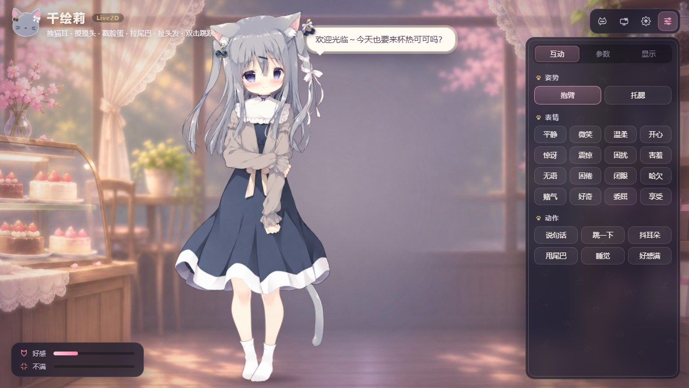

# 雪村千绘莉 · Live2D 风格互动桌面宠物

简体中文 | [English](README.en.md)



用两张平面立绘（`1.png` / `2.png`）和 `chc/` 里的表情差分，做成可以实时互动的 Live2D 风格角色：她会呼吸、眨眼、东张西望，拽耳朵会生气，摸头会脸红。加载时在浏览器里把立绘切成几个图层、铺上网格，用手写的形变器实时变形，WebGL2 画出来。没有 Cubism、没有 `.moc3`，也没有任何运行时依赖。

同一套页面也被 Electron 包成了 Windows 桌面宠物（托盘、透明窗口、开机自启）。可以接自己的大模型 API 和她聊天、让她对触摸做出反应，也可以用在线 TTS 或内置的 GPT-SoVITS 声线把台词读出来。

> 这份是使用说明。代码结构、改动方法和开发注意事项见 [CLAUDE.md](CLAUDE.md)。

## 从源码运行

- **网页版**：Windows 上双击 `start.bat`，它会启动本地服务器（`serve.ps1`，端口 8765）并打开 http://localhost:8765/ 。用别的静态服务器也行，但必须通过 http 访问：浏览器禁止在 `file://` 下读取图片像素，而表情遮罩要在加载时计算。
- **桌面版**：需要 Node 22 或更新版本。

  ```bash
  npm install
  ```

  ```bash
  npm start
  ```

**仓库里没有的东西**：

- 本地声线模型包 `voice/Chieri_GPTSoVITS_20261103/`：约 1.4 GB，超出了 GitHub 的大小限制。没有它，程序照常运行，只是语音设置里没有「千绘莉声线」。可以用在线语音引擎，或者对接你自己的 GPT-SoVITS 服务。
- 安装包（由 `npm run dist` / `npm run dist:lite` 生成，见「打包」）、`node_modules/`，以及宣传视频的工程。

## 运行（安装包）

- **桌面版（推荐）**：有两个安装包，开始菜单和桌面都会有「千绘莉」快捷方式。安装包由 `npm run dist` / `npm run dist:lite` 生成（见「打包」），仓库里不带。
  - `dist/千绘莉-完整版-Setup-<版本>.exe`（约 1.2 GB）：内置千绘莉专属的 GPT-SoVITS 声线模型，可以用本地语音，也可以用在线语音。
  - `dist/千绘莉-在线版-Setup-<版本>.exe`（约 145 MB）：不带模型，体积小，只能用在线语音服务。
  - 覆盖安装可直接选择装有千绘莉的旧目录，包括自定义旧位置或安装登记缺失的旧位置。全新位置请选择空目录。正常覆盖安装和卸载会保留用户设置及数据库。使用早期版本首次覆盖升级时，先从托盘退出千绘莉，旧卸载程序仍可能调用早期的 Python 进程扫描。
## 桌面宠物

主窗口右上角的显示器图标切换到桌面模式：她会单独站在桌面上，没有背景和边框。

- 只有她身上的像素会挡住鼠标，旁边的透明区域可以直接点到下面的窗口。
- **菜单**：平时收成右上角的一个小圆点，鼠标停在她身上时才会显出来。鼠标放到圆点上，工具条才展开（拖动、对话、调整大小、设置、回到主窗口、更多），移开就收起。
- **搬动她**：按住展开的工具条（按钮以外的地方，比如最左边的拖动图标）拖动。被拎着时她会晃来晃去，放下时有落地的动作。
- **大小**：可以无级调节：
  - 点工具条上的调整大小按钮，或在右键菜单里选「大小 → 无级调节…」，然后拖左上角的圆点、滚动滚轮或点 −/＋ 调整，点「完成」或按 Esc 结束；
  - 也可以按住 Ctrl 在她身上滚动滚轮；
  - 设置里的滑块拖动时会实时预览。
  - 范围是 40%–250%，但不会超过屏幕高度。
- **对话和设置**：窗口会往左边加宽一栏来放，不会挡住她。她说的话显示在头顶上方的空白处。
- 她的视线会跟着鼠标走，整个屏幕范围都算。
- 右键她或托盘图标可以设置：
  - **显示层级**：最前（盖过全屏程序和任务栏）、置顶（在普通窗口上面）、普通（和其他窗口一样）。
  - **大小**、**鼠标穿透**（完全不挡操作，从托盘图标关闭）。
  - **开机自动启动**；
  - 隐藏到托盘、退出。
- 位置、层级、大小都会记住；设置里可以勾选「启动时直接进入桌面模式」。
- **开机自动启动**：在设置的「桌面宠物」里勾选，也可以在右键菜单或托盘菜单里打开。
  - 开机后按「启动时直接进入桌面模式」决定打开桌面宠物还是主窗口；它不会抢走你正在用的窗口的焦点。
  - 如果在任务管理器的「启动应用」里把它禁用了，设置里会提示，重新勾上就会恢复。
  - 卸载时会一起删掉这一项；覆盖安装新版本不受影响。

## AI 对话

点 ⚙ 设置，选择服务商并填 API Key、模型：

- 支持 DeepSeek、通义千问、Kimi、智谱、OpenAI、Claude、本地 Ollama，或任意兼容 OpenAI `/chat/completions` 的接口。
- 「测试连接」可以先试一次。

配置好以后：

- **对话窗口**（💬）：和千绘莉聊天。模型按人设回答，同时决定她的表情（开心、害羞、赌气……）、动作（跳、甩尾巴、抖耳朵、冒爱心……）和好感变化，她会当场做出来。
- **AI 触摸反应**：打开后，摸头、拽耳朵、戳脸这些互动会被描述给模型，由它生成反应台词，代替固定台词。身体动作仍然立即发生，台词在回复到达前显示「…」。连续快速触摸时，会改用固定台词。
- **人设**：默认人设就是 `rg.txt` 里的角色设定（俄罗斯蓝猫兽人、自居前辈的傲娇店员，不说「喵」），名字和人设都可以在设置里改。旧版本保存的默认人设会自动换成新的；自己改过的人设不会被覆盖。
- **你的称呼和生日**：在设置的「角色」里填写，两个都可留空。称呼用于开场白和 AI 对话。生日只选月和日，当天开场会送上祝福。2 月 29 日按实际日期匹配。聊天服务可收到称呼和「今天是生日」的提示，具体月日由应用本地保存。
- 她的回复里可以用（）穿插神态描写，比如「（猫耳抖了抖）」：气泡里照常显示，朗读时会跳过。
- **隐藏聊天栏**：在设置里勾选后，对话时只剩一个输入框，不显示聊天记录，她的回复只出现在头顶的气泡里。按 Esc 或输入框左边的 × 收起。

数据保存：

- 桌面版的 API Key 用系统加密（Windows DPAPI）保存在本机用户目录里。请求从程序主进程直接发给你填写的接口地址，没有跨域问题。
- 网页版保存在浏览器 localStorage 里。部分服务商会拦截浏览器跨域请求。
- 没有配置 AI 时，对话窗口用几句关键词回复，互动用固定台词。
- 设置按类别导航，滚动会高亮当前类别。修改后点底部「保存全部」，关闭前会提示尚未保存的改动。

## 语音

设置 → 语音，选一个语音引擎，她说的每句话就会读出来（可以分别开关「朗读聊天回复」和「朗读触摸反应和日常台词」）。播放时嘴型跟着声音的响度动。点「试听」可以先听一句。

| 引擎 | 说明 |
| --- | --- |
| 千绘莉声线（本地 GPT-SoVITS，日语） | 只有完整版有。内置的专属模型（B站 雪村落雪 提供的 v2ProPlus 模型），**只会说日语**：固定台词已经附了日语译文（`js/lines_ja.js`），AI 的回复会让 AI 模型同时给出日语版，其他句子临时让 AI 翻译（所以要先配置 AI 服务）。在本机运行，需要 Python 环境，推荐 NVIDIA 显卡 |
| GPT-SoVITS 接口（api_v2） | 只有完整版有。对接你自己启动的 GPT-SoVITS `api_v2.py`（本机或局域网），模型和参考音频在服务那边设置 |
| OpenAI 兼容 | OpenAI、硅基流动等兼容 `/audio/speech` 的服务 |
| Fish Audio / ElevenLabs / Azure 语音 | 填 API Key 和音色 ID（Azure 填区域、密钥、音色名） |

除了千绘莉声线，其他引擎都不限语言：默认直接读中文原文；用日语音色时可以把「朗读语言」改成「先翻译成日语再朗读」。

> 感谢模型提供者，B站id：雪村落雪提供的模型。（完整版内置的千绘莉声线：GPT 第 50 轮 / SoVITS v2ProPlus 第 20 轮）

**本地声线的运行环境**（第一次用时）：

1. 需要 64 位的 Python 3.12（从 python.org 安装）。
2. 在语音设置里选「千绘莉声线」，点「一键安装环境」。程序会在 `%LOCALAPPDATA%\chieri-tts` 建一个独立的 Python 环境，装 PyTorch 2.7.1 和模型要求的依赖：有 NVIDIA 显卡时装 CUDA 12.8 版（下载约 3 GB），没有就装 CPU 版。国内网络可以勾选「使用国内镜像」（依赖从清华源下载；PyTorch 仍从官方源下载）。安装时按钮下面有一条**进度条**：显示现在是第几步（查找 Python → 创建虚拟环境 → 安装 PyTorch → 安装 GPT-SoVITS 依赖 → 检测环境）、总进度，以及正在下载哪个包、下了多少、速度和大概还要多久；条纹在流动表示这一步正在进行但没法精确计量（例如解压安装大量文件时）。完整的输出在下面的日志框里。**进度条显示「安装完成，运行环境已就绪」之前本地声线用不了**，这期间她说话不会出声；失败或取消时进度条变成暗红色，写明停在哪一步、为什么。安装中途被取消、断网或关掉程序的话，按钮会变成「继续安装」，点它接着装（已经装好的包不会重新下载）。
3. 装好后保存设置，模型会在后台加载，加载完成会有提示。之后每次启动都会自动加载。第一次加载要一两分钟，其中导入 PyTorch 那一段日志里很久没有新内容（每 20 秒会提示一次「仍在加载」），**不用点「加载 / 重启模型」**：加载中点它不会打断（3 分钟还没好才会真的重启）。
   - 如果某一步超过 1 分半钟，日志里会出现一段以「Timeout」开头的内容，那是它此刻正在执行的代码。超过 10 分钟还没加载好，就会停下来报错。遇到这种情况，把语音设置下面的整段日志复制下来发给开发者，就能看出卡在哪里。
4. 已经有能跑 GPT-SoVITS（需要支持 v2ProPlus 的版本）的 Python 环境的话，直接在「Python」一栏填它的 `python.exe`，不用安装。「检测环境」会列出 Python / PyTorch 版本、显卡和缺少的模块。

本地合成比在线服务慢：有显卡时一句话一两秒，只用 CPU 会慢很多。可以点「预生成固定台词」，把全部固定台词提前合成好存起来，之后摸头、拽耳朵这些反应会立刻出声（生成过的语音存在用户目录的 `tts-cache` 里，所有引擎通用，最多约 400 MB）。AI 回复每次都不一样，只能现合成：文字会稍等一下声音，最多等 10 秒（触摸反应 6 秒），超时就先显示文字。

**换了模型或更新之后**：

- 加载的永远是安装目录里实际存在的那两个权重文件。语音设置里会显示加载的是哪个（例如「模型已加载（NVIDIA 显卡 · 雪村落雪 · GPT-e50 / SoVITS-e20 afb37bc7）」，后面是 GPT 权重哈希的前 8 位）；权重和模型包里记录的哈希对不上时会注明「和模型包记录的不一致」，但照样加载，不会因此启动失败。
- 生成过的语音按权重文件区分：权重一换，旧模型合成的缓存就不再使用，程序开着时换了权重文件，下一句话会自动重启模型。
- 上次没有正常退出、还在后台加载的语音进程（会占着显存和安装目录里的文件）会在第一次加载模型前自动结束，日志里会写「已结束 N 个上次残留的语音进程」。
- 模型加载失败时，打开设置 → 语音，日志框里有完整的出错信息。

卸载程序不会删除 `%LOCALAPPDATA%\chieri-tts`（约 5 GB），不再需要时手动删掉这个文件夹即可。

在线服务的 API Key 和 AI 的 Key 一样用系统加密保存。网页版只能用在线引擎，而且可能被服务商的跨域策略拦截。

## 中英文切换

在设置顶部点「English」或「中文」，界面、新对话、预设互动台词、开场白、日常语气词和主动闲聊会切换语言。桌面窗口共享该偏好，网页版单独记住选择。聊天记录、提醒标题和记忆内容按原文保留。日语声线仍使用日语。英文聊天可用 “Remember that I like coffee” 保存记忆，或说 “Remind me tomorrow at 09:00 to call home” 创建提醒。

## 记忆与数据（Windows 桌面版）

在设置中打开 **记忆与数据**。本地规则默认开启，符合条件的内容直接保存。说「千绘莉，记住我喜欢喝冰美式」可明确保存，之后说「更正：我不喜欢喝冰美式」会归档同一偏好的旧说法。没有 AI 配置也能使用。已有用户选择的模式会保留。

- 配置、加密密钥和记忆位置保存在 **%APPDATA%\千绘莉\**。默认库位于 **%LOCALAPPDATA%\千绘莉\memory\memory.sqlite**，数据库备份在当前库的 **backups** 子目录。
- 「迁移到新目录」先创建并核对快照，再切换位置。旧目录会保留。磁盘不可用或数据库损坏时，用「重新定位已有库」或「恢复数据库备份」。恢复会保留目标库的原文件。确认新位置和备份后，可在文件资源管理器中处理旧副本。
- 首次运行会按原顺序导入旧桌面聊天。没有时间戳的旧记录显示估算的导入时间。「打开记忆与聊天管理」会打开独立窗口，默认列出已有记忆，每页 12 条。可搜索、按类型与归档状态筛选、编辑重要性和有效期。聊天记录按轮分页，可搜索、删除或清空。桌面聊天不会按时间自动清理，网页版用浏览器存储。
- 长期记忆本地保存。开启时，相关条目可能随当前聊天发给你配置的模型服务。可查看最近一次 AI 聊天附带的记忆，或关闭长期记忆引用。最近聊天仍作为当前对话上下文。记忆文件和数据库备份没有应用层加密。
- JSON 导出只包含当前长期记忆，不包含聊天和设置。SQLite 备份包含聊天原文及归档记忆，请妥善保管，并将重要备份复制到另一块磁盘。换设备或 Windows 账户后，原有 DPAPI 密钥可能无法解密，需要重新配置 API Key。
- **记忆与数据**可选择关闭自动提取、本地规则或 AI 辅助。AI 辅助保留本地规则，等旧消息因超过 16 条或 6000 字符而移出近期聊天上下文时，才可能向聊天服务发送最多三条筛选后的用户消息。仍限制为每十分钟最多一次、每 24 小时最多六次。通过验证后自动入库，已有记忆的检索仍按当前提问的相关性进行。
- 本地规则可按偏好、习惯或技能、长期目标、重要经历和住处或职业分别启用。可调整记忆引用条数和字节数，也可查看最近一次 AI 对话引用的记忆及匹配词。
- 升级到 SQLite schema 3 前，会在当前库的 `backups` 目录保存已校验的一致性快照。用早期程序回退时，需要使用升级前的快照。当前构建统一标为 **1.2.8**，数据库兼容性以 schema 版本为准。

## 提醒、主动互动和屏幕查看

- **生活提醒**可以分别开启喝水、起身和夜深提醒。喝水和起身按电脑活跃时间累计，可选 30、45、60、90 或 120 分钟，同时到点时合并为一条。夜深提醒默认本机 23:30，每晚最多一次，恢复活动才显示，到次日 06:00 时跳过。语音和系统通知可分别开启。
- **本机时间**：说「现在几点？」可以直接查设备时间。聊天、主动问候和桌宠开场白会参考本机时段。
- **提醒与日程**可手动创建单次、每天、每周、工作日或自定义星期的提醒，时区默认本机，也能从列表选其他时区。还可以说「明天十点提醒我开会」，核对后保存。通知和语音分开开关，已配置的 Chieri 声线可在没有聊天 API 时使用固定日语句式播报。应用退出或电脑睡眠期间错过的提醒会在打开或唤醒后列出，可补发、延后或完成。
- **主动闲聊**默认关闭。可选约 10–20、20–40、45–90 分钟的基础间隔，也可自定义最小间隔。可设置安静时段、每日上限、自适应强度、AI 台词、长期记忆引用和朗读。托盘菜单可暂停闲聊，日程提醒继续运行。用户互动、日程提醒和正在播放的语音优先。
- 要让千绘莉偶尔结合屏幕内容发起话题，在「主动互动」打开 AI 台词和「主动闲聊时查看屏幕」，选每几次查看一次，再点「保存全部」。配置视觉 API 后，从「屏幕来源与隐私」自动列出的显示器或窗口中选择来源，预览并确认一次。授权会保存，锁屏时暂停，解锁后可继续。可以随时撤销。更换共享来源或服务时需要重新授权。可修改隐私关键词。窗口标题匹配时跳过截图；视觉描述匹配时不会转发给聊天服务，画面中的文字仍可能已传给视觉服务。
- **视觉感知**默认关闭，有独立的视觉模型和密钥。先选择显示器或窗口，在本地预览，再确认发送或启动最长 30 分钟的定时查看。锁屏、休眠、窗口隐藏或会话到期时自动停止。截图在内存中处理，视觉描述可交给角色回应、朗读、清除或点击保存到长期记忆。托盘也可停止查看。
- 提醒、生活提醒和主动互动配置会随数据库备份、恢复和迁移。提醒 JSON 可单独导出，导入项默认暂停。视觉设置单独保存，密钥使用 Windows 安全存储加密。
- **主动互动**会显示当前陪伴状态、原因和上次主动发言时间。开启自适应后，连续多次未收到聊天回应会延长主动闲聊间隔。可以说「现在别打扰我」「接下来一小时我要专心工作」或「可以陪我聊聊天」。直接修改长期频率的聊天请求会先要求确认，日程提醒照常。
- **动作与语气词**可关闭，或选择约 1–2、5–10、15–30 或 30–60 分钟一次。默认 5–10 分钟，日常动作和语气词同步触发。六组台词和动作按随机顺序轮流播放，同一次运行中避免相邻重复。忙碌、安静或休眠时顺延。

## 录制模式

拍宣传视频用。按 F8 打开，也可以在「显示」面板里打开；桌面版还可以在右键菜单或托盘菜单里打开。打开以后：

- 她不会自己做小动作、闲聊或睡着，只偶尔抖抖耳朵、甩甩尾巴，长镜头不会被打断。
- 每个互动都固定说同一句台词：`config.js` 里每组台词的第一句，和视频分镜对得上。
- 触摸反应默认不走 AI。录「AI 触摸反应」那个镜头时按 I 临时打开。

快捷键（左边的快捷键表上也有，按 H 收起）：

| 键 | 作用 |
| --- | --- |
| 1–9 | 伸懒腰、打喷嚏、回头看尾巴、哼歌、东张西望、凑近偷看、蹦跶、抖耳朵、打盹点头 |
| J | 跳一下 |
| A | 赌气别过脸，摸几下头才哄得好 |
| S | 打个哈欠后睡着，动一下鼠标就醒 |
| F | 定格：完全静止，像原始立绘一样，点到她身上才动起来（拍开场用） |
| R | 复位：清掉生气、睡着、气泡和表情 |
| P | 换姿势 |
| M | 显示变形网格 |
| L | 好感满的特别动作 |
| I | AI 触摸反应开 / 关 |
| U | 隐藏标题、好感条、按钮和面板，画面里只剩她 |
| H | 收起 / 显示快捷键表 |

窗口在前台时直接按键；在输入框里打字不会触发。桌面版在录制模式下还可以按 Ctrl+Alt+同一个键，这样 OBS 或别的窗口在前台时也能用。这些组合键只在录制模式开着时占用，关掉就还给系统。

## 打包

用 Node.js 24 运行 `npm test`。用 `npm run dist:lite` 构建在线版。完整版通过 `npm run dist` 构建，需要提前将现有完整安装的 `resources\voice\Chieri_GPTSoVITS_20261103` 模型目录复制到项目的 `voice\` 下。联网依赖安装后，如 Electron 运行时还未下载，可运行 `node node_modules/electron/install.js`。

```bash
npm run dist
```

```bash
npm run dist:lite
```

用 electron-builder 打成 NSIS 安装包，输出到 `dist/`：`dist` 是完整版（`build/full.config.js`，把 `voice/` 整个放进安装包），`dist:lite` 是在线版（`build/lite.config.js`）。需要 Node 22 或更新版本，第一次先运行 `npm install`。完整版需要先把 `Chieri_GPTSoVITS_20261103.zip` 解压到 `voice/` 下（得到 `voice/Chieri_GPTSoVITS_20261103/`），再用 `io/` 里雪村落雪提供的两个权重（`千绘莉-e50.ckpt` → `delivery/chieri-gpt.ckpt`，`千绘莉_e20_s6420.pth` → `delivery/chieri-sovits.pth`）替换，并把模型包里记录的哈希一起改掉（见 `CLAUDE.md`「历史」），否则语音设置里会提示权重和记录不一致（仍然能用）。仓库里不带模型包和 `io/`。完整版安装包的完成页上会写明模型提供者（`build/installer-full.nsh`）。

界面用的图片在 `img/`，由 `tools/ui-art.ps1` 从 `art/` 里的原图（GPT Image 生成，提示词在 `art/千绘莉化_提示词.md`）抠图、裁切、缩放得到；安装界面的侧边图和页眉图由 `tools/installer-art.ps1` 生成。换了原图之后重新跑这两个脚本即可。

`electron/` 下是桌面外壳：`main.js` 负责窗口、托盘、设置和 AI 请求，`voice.js` 负责语音（在线请求、缓存、本地模型进程和环境安装），`preload.js` 是页面和外壳之间唯一的接口。

## 互动

| 操作 | 反应 |
| --- | --- |
| 拖拽猫耳 | 耳朵被拉长，○○ 震惊脸 + 冒汗，头被拽着倾斜发抖；松手后耳朵弹回并抱怨 |
| 单击猫耳 | 耳朵抖动 |
| 在头顶来回抚摸 | 眯眼享受、脸红、耳朵压平、冒爱心和音符，好感上升 |
| 单击脸蛋 | 脸颊被戳凹陷；连续戳 5 下会生气 |
| 拖拽尾巴 | 尾巴跟随鼠标，炸毛甩动 |
| 拖拽双马尾 | 头发被拉动，困扰表情 |
| 单击发夹 / 脖子 / 手 / 胳膊 / 蝴蝶结 / 胸口 / 肚子 / 裙子 / 腿 / 脚 | 各有不同反应：脖子怕痒缩脖子、耳朵压平；肚子被戳会缩一下；摸腿会脸红后退；挠脚会咯咯笑着发抖；手会害羞冒爱心……每次被碰她都会看向那里，尾巴也会甩一下 |
| 拖拽手（牵手）/ 胳膊 / 推胸口或肚子 | 身体以髋部为轴跟着倾斜（被拉过去或被推开），松手后带着回弹晃回来；牵手时持续冒爱心 |
| 双击身体 | 跳一下 |
| 拉裙摆 | 裙摆跟着手被拉开或掀起，她红着脸慌张地抗议，身体往反方向躲；拉太久会真的生气。松手后裙摆弹回去、晃几下 |
| 不操作 | 呼吸、眨眼、头发 / 裙摆随风。每隔十几秒还会自己做点小动作：东张西望、哼歌摇头、伸懒腰、打喷嚏、追着看尾巴、抖耳朵、凑近偷看、蹦跶，困了还会打盹点头 |
| 好感涨满 | 特别动作：先吃一惊，接着脸红、耳朵压平、视线躲开，然后说一句特别的话（傲娇地表白），胸口炸开一圈爱心，身后亮起粉色的光和一颗大爱心，最后开心地跳一下。好感条满格时会跳动发光。好感降到 85% 以下再涨满，才会再来一次。右侧面板「好感满」按钮可以直接看 |
| 鼠标长时间不动 | 先犯困，再睡着（Zzz）。默认 3 分钟，可以在设置里改成 1 / 5 / 10 分钟或从不。鼠标一动就醒：先睁眼惊一下，环顾四周，伸个懒腰，然后才开口说话 |

### 尾巴与全身联动

尾巴的摆动节奏跟着心情变：平静时慢慢摇，开心（被摸头、笑）时大幅度地慢摆，生气时快速甩动，被拽耳朵 / 尾巴时绷紧发抖，犯困时无力下垂。同时它和身体耦合：身体摇摆、被推拉倾斜、跳起落地、挤压回弹时，尾巴都会滞后摆动来平衡；反过来，拽尾巴时她会扭头去看，身体也被往那边带。

「不满」累积过多时会赌气别过脸不看你，摸头可以哄好。右侧面板可切换姿势（抱臂 / 托腮）、手动切换表情，并像 Cubism Viewer 一样拖动参数滑块（头部 XYZ、身体、闭眼、张嘴、耳朵、尾巴、脸红、呼吸），还可以打开「显示网格」查看变形网格。

### 界面

主窗口里她站在一间咖啡店里。「显示」面板最上面可以换背景：**自动**（6 点到 18 点是白天的店里，其余时间是夜晚）、白天、夜晚、纯色（以前的深色渐变）。桌面模式没有背景。对话窗口顶上趴着一个小千绘莉，设置窗口上她从边上探头；提示消息、对话里的欢迎和出错提示配着她的表情贴纸，等 AI 回复时会显示她托腮思考的样子；头顶冒出的爱心、音符、汗滴等特效也换成了插画。

## 实现说明

- `chc/chi12*` 的表情精确对齐到 `1.png`，`chc/chi11*` 对齐到 `2.png`（由 `tools/align.html` 用梯度 NCC 搜索出缩放与位移）。
- 加载时自动计算每套差分中真正变化的区域（眼、眉、嘴、红晕），只在该区域羽化贴合，所以表情与立绘之间没有接缝；眨眼使用闭眼帧与半闭眼帧的眼部遮罩叠加在任意表情上；说话时在「a」差分（张嘴）之间切换。
- 形变器：头部（伪 3D 转头视差 + 绕颈部旋转）、双耳、双马尾/鬓发（弹簧摆物理）、尾巴（独立图层，可大幅拖拽）、呼吸、身体摇摆、裙摆滞后、戳脸凹陷、跳跃挤压。
- 头发弹簧只作用于真正的头发像素：加载时从每一缕头发的中心线出发，在「冷灰色」像素上泛洪填充，遇到深色线稿就停下。所以颜色和头发很接近的开衫、袖子，也因为有轮廓线隔开而不会被拽着走。
- 双马尾（连同发带、蝴蝶结）在加载时被切成独立图层，整束摆动，不再和下面的袖子共用一张网格。马尾摆开时，后面露出的是延伸过来的鬓发和袖子，不会和头发之间裂开一道缝。
  - 每个姿势的每条马尾在 `config.js` 里都有一条手描的轮廓（`poly`）：外侧走背景，内侧沿着马尾和鬓发之间的空隙或线稿，顶部在发绳 / 发夹处横切。轮廓里的东西整块切走，所以马尾不会被拆成零碎的几缕。只有轮廓和躯干轮廓（`torso`）重叠的地方，才按颜色区分头发和袖子。
  - 切口下面：发绳附近保留原图（根部几乎不动，甩开时露出来的还是头发）；马尾贴着鬓发的地方，把鬓发的颜色往里延伸约 20 px，稍微压暗，像在马尾的阴影里；躯干上用周围衣服的颜色补齐（push-pull），并延伸出躯干轮廓一点；其余地方留空。
  - 马尾跟随转头、歪头的程度（以及后发视差）在身体层和马尾层上用同一个函数计算，所以转头时切口不会裂开。
- 裙摆下半部分也是独立图层，只包含布料（深蓝裙身、白色花边和它的阴影；皮肤是暖色，不算布料）。下面的身体层把腿按列向上延伸到裙子里面，所以拉起或拉开裙摆时，露出来的是腿，腿本身不会被拉变形。
- 安装包的侧边图和页眉图由 `tools/installer-art.ps1` 从 `1.png` 生成，欢迎页和完成页的文字在 `build/installer.nsh` 里。
- 双马尾被拉动时，整束绕发绳 / 发夹处的根部转动：越往下转得越多，抓住的那一点跟着手走，抓点以下的发梢跟着整体转，长度只能伸缩一点。所以根部始终扎在发绳上，发梢也不会和马尾断开；抱臂姿势里绕过左臂的那一圈马尾也整圈跟着走，不会粘在胳膊上。马尾离开后露出的袖子按行重建：布料补到袖子原本的外缘（被发丝挡住的缺口会被桥接上，被一整段头发盖住的地方按上下露出来的轮廓连成直线），被头发挡住的那段轮廓线补画出来，外面留空。
- 拉裙摆时，尾巴根部会跟着裙摆一起动，不会停在原地。
- 配置在 `js/config.js`（各部位坐标、表情映射、台词），台词的日语版在 `js/lines_ja.js`，形变在 `js/rig.js`，渲染与交互在 `js/app.js`，语音在 `js/voice.js`，AI 客户端和设置存储在 `js/ai.js`，对话窗口、设置面板和桌面宠物交互在 `js/ui.js`。本地声线的服务程序是 `voice/chieri_server.py`。

注：这是在网页中实现的 Live2D 风格绑定，不是 Cubism Editor 导出的 `.moc3` 模型。
